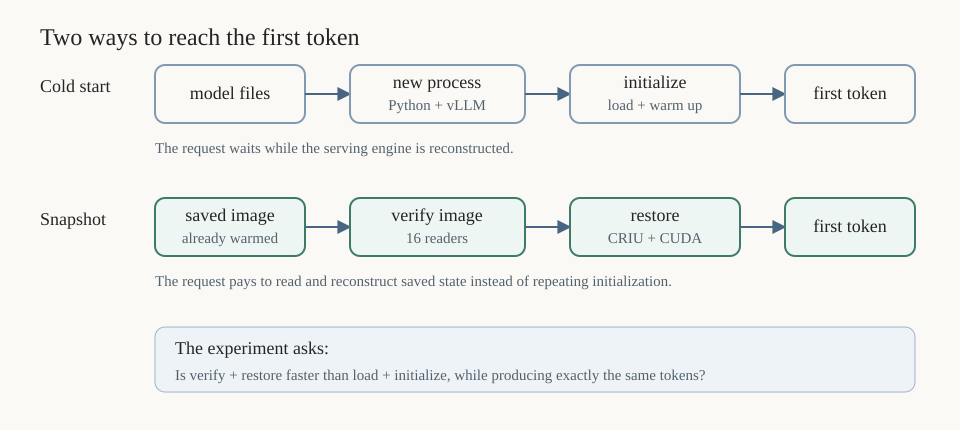
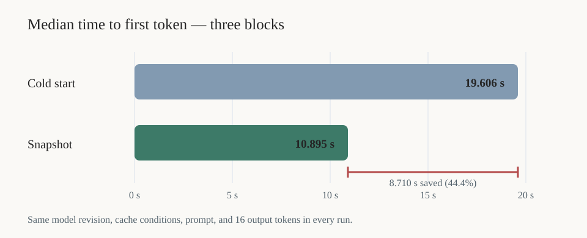

# Running the vLLM snapshot comparison

**Complete on Qwen2.5-0.5B.** A fresh Jarvis Labs H100 replication measured a
19.61 s median cold start and a 10.90 s median snapshot activation: **44.4%
lower TTFT**. Repeated earlier on another H100 host with 16x faster storage,
where the gap first widened to 5.96 s
([storage arm](../results-detail.md#h100-storage-arm-the-disk-stops-binding-and-our-own-reader-takes-over--2026-09-18))
and then reverses to a 6.81 s win once the payload hash runs in parallel
([payload policies](../results-detail.md#two-payload-policies-the-hash-was-also-a-prefetch--2026-09-18)). The
[plan](../../docs/vllm-snapshot-plan.md) owns the requirements and the stop
conditions; this file owns the commands. Capture, restore, eviction and
ownership are reused from the [inference runbook](../inference/README.md).

## What the comparison means

A cold start reconstructs the serving engine from model files. It imports the
runtime, loads weights into GPU memory, prepares the key-value cache, and performs
warm-up work before it can return a token.

A snapshot starts from a saved, already-warmed process. CRIU restores CPU memory
and Linux process state, while its CUDA plugin restores GPU state. The experiment
asks whether reading that larger image costs less than repeating initialization.



*Both paths end at the same first token. The work before it is different.*

```text
cold start
model files -> Python/vLLM -> weights in GPU -> warm-up -> first token
                |---------------- 19.61 s median ----------------|

snapshot activation
saved process image -> CRIU + CUDA plugin -> resumed worker -> first token
                       |----------- 10.90 s median -----------|
```

The snapshot saved 8.71 s in this campaign. It did not make token generation
itself faster; it shortened the work required before the first request could run.

```text
assets -> gate 2 probe (0.5B) -> diagnostics (cold, eager, snapshot) -> timing blocks
             capture/restore            one per route                  three per route
```

## Environment

vLLM needs its own interpreter. The original A10G host had driver 570.172.08, so
the newest usable release there was **vLLM 0.19.1** with torch 2.10.0 (CUDA 12.8):
vLLM 0.20 and later pin CUDA 13 PyTorch wheels that require driver 580 or newer.
The Jarvis H100 had driver 580.126.20, but retained vLLM 0.19.1 so the engine
version stayed comparable with the earlier campaigns.

```bash
BASE=/opt/dlami/nvme/gpu-checkpointing-vllm
python3 -m venv "$BASE/venv"
TMPDIR="$BASE/tmp" "$BASE/venv/bin/python" -m pip install "vllm==0.19.1"
export TMPDIR="$BASE/tmp" HF_HOME="$BASE/cache/huggingface" XDG_CACHE_HOME="$BASE/cache"
export TORCH_HOME="$BASE/cache/torch" CUDA_CACHE_PATH="$BASE/cache/cuda"
export VLLM_CACHE_ROOT="$BASE/cache/vllm"
PY="$BASE/venv/bin/python"
TOOLS="$PWD/runs/tools"
```

Images go on instance storage: EBS has 19 GiB free, which will not hold one.

## Command contract

| Program | Arguments |
| --- | --- |
| `assets.py` | `--model PATH --source PATH --output PATH --gpu-fraction F [--max-model-len N]`. Records the reference tokens vLLM itself produces. |
| `trial.py trial` | `--route cold\|eager\|snapshot --kind diagnostic\|timing --assets PATH --output PATH --tools PATH --timeout SECONDS`. |
| Timing options | `--validated-run PATH --block 1\|2\|3`. |
| Conditions | `--data-cache uncontrolled\|cold`, `--compile-cache warm\|cold`, `--poll-ms 5`, `--sample-ms 100`. |

Output directories must be new. The route is not a comparison-key setting, so
the three routes of one campaign share a key and can be aggregated; every other
setting must be identical across them.

## Prepare

```bash
MODEL="$PWD/runs/tools/qwen2.5-0.5b"        # gate 2 probe; 8B for the headline
CAMPAIGN=/opt/dlami/nvme/gpu-checkpointing-vllm/campaigns/qwen25-05b-a10g-01
ASSETS="$CAMPAIGN/assets"
mkdir -p "$CAMPAIGN"
"$PY" experiments/vllm/assets.py --model "$MODEL" \
  --source "$MODEL/asset-manifest.json" --output "$ASSETS" --gpu-fraction 0.30
```

## Gate 2: capture and restore once

```bash
"$PY" experiments/vllm/trial.py trial --route snapshot --kind diagnostic \
  --assets "$ASSETS" --output "$CAMPAIGN/diagnostics/snapshot" \
  --tools "$TOOLS" --timeout 3600
```

This passes. Nothing extra is needed to make it pass: `engine.py` sets
`USE_LIBUV=0` and `session.py` dumps with `--tcp-established`, which together
remove the io_uring ring and the self-connected socket that CRIU refuses. Run
the `cold` diagnostic the same way before any timing.

Run both diagnostics with the same `--data-cache` setting the timings will use:
the condition is part of the comparison key, so a cold timing needs a cold
diagnostic. It matters more than it looks — an image written moments earlier is
still in the page cache, and a restore that reads it from there measures nothing.

## Timing blocks

Each timed run cites its route's accepted diagnostic. Warm the compiled-kernel
cache once with a throwaway activation; `--compile-cache warm` refuses an empty
cache, because a first block that had to compile would be charged for work the
other two inherit.

```bash
for block in 1 2 3; do
  for route in cold eager snapshot; do
    "$PY" experiments/vllm/trial.py trial --route "$route" --kind timing \
      --block "$block" --validated-run "$CAMPAIGN/diagnostics/$route" \
      --data-cache cold --compile-cache warm \
      --assets "$ASSETS" --output "$CAMPAIGN/timing/$route-$block" \
      --tools "$TOOLS" --timeout 3600
  done
done
```

### Jarvis Labs H100 replication — 2026-09-29

The replication used an H100 80GB, driver 580.126.20, vLLM 0.19.1, torch
2.10.0+cu128, a cold data cache, and a warm compile cache. The snapshot route
used `parallel-chunked-v1` with 16 verification workers.

| Block | Cold TTFT | Snapshot TTFT | Snapshot advantage |
| --- | ---: | ---: | ---: |
| 1 | 19.959 s | 11.237 s | 8.722 s |
| 2 | 19.606 s | 10.895 s | 8.710 s |
| 3 | 19.533 s | 10.809 s | 8.724 s |
| **Median** | **19.606 s** | **10.895 s** | **8.710 s (44.4%)** |



All six runs returned the same 16 token IDs. In every snapshot run the original
worker was reaped, capture and restore exited, image hashes matched, and cleanup
completed. The [detailed record](../results-detail.md#jarvis-labs-h100-replication--2026-09-29)
explains the evidence and limits.

## Tests

```bash
PYTHONPATH=experiments/inference:experiments/finetuning:experiments/criu:experiments/cpu \
  python3 -m unittest discover -s tests -v
```

## Running on other hardware

The result here is storage-bound, so another host can reverse it. Faster storage
alone did not: the binding cost became our own serial payload hash instead.
Changing that policy did. Re-derive these before trusting any comparison on a
new machine, and measure the rate the activation achieves, not the device's.

| Re-derive | Why | How |
| --- | --- | --- |
| vLLM version | wheels past 0.19.1 pin a CUDA 13 torch needing driver 580+ | read the wheel's `Requires-Dist` for `nvidia-*-cu12` against `cu13` |
| volume bandwidth | it decides the answer | read the raw device, as in the [bandwidth measurement](../results-detail.md#both-volumes-are-bandwidth-limited-and-our-loaders-already-saturate-them--2026-09-18) |
| `--gpu-fraction` | the preallocated key-value cache is image bytes | keep it low, or unmap the cache before capture |
| compiled-kernel cache | `warm` refuses an empty cache | one throwaway activation first |
| CRIU tools | built per host | rebuild under `runs/tools` |

The snapshot wins when reading the image costs less than the startup it removes:

```text
image_bytes / bandwidth  +  restore overhead   <   cold TTFT
  6.42 GiB / 0.21 GiB/s  +  ~0 s               <   27.65 s      -> 30.6 s, lost
  6.42 GiB / 2.00 GiB/s  +  ~3 s               <   27.65 s      -> 6.2 s, won
```

Bandwidth here means the rate the activation actually achieves, not the device's.
The H100 arm reads at 0.52 GiB/s from a 5.0 GiB/s device, because validation
hashes the payload serially in 4 MiB reads.

Run a fresh campaign directory and fresh assets: assets record the engine
configuration, and images are bound to the checkout path that produced them.

## Startup phase diagnostics

Diagnostic workers now emit `startup-phases.jsonl`; timing workers install no
tracing hooks. Each span records start/end monotonic timestamps, process ID,
duration, and failure status. An interrupted start remains visible without an end.

```text
Python imports -> tracing imports -> engine initialization -> final CUDA sync
                                    | device initialization
                                    | model loading
                                    | profiling / available-memory calculation
                                    | KV-cache initialization
                                    + compilation / warmup / graph capture
```

Worker spans are nested inside engine initialization: do not sum parent and child
durations. These are CPU-observed method boundaries, not separate disk, PCIe, or
GPU-kernel timings. No synchronization is added inside worker methods.

Use this diagnostic to select an intervention, then compare untraced runs.
The recorder targets the in-process V1 worker and fails if a required method is
missing; a different vLLM version needs a fresh compatibility check.
